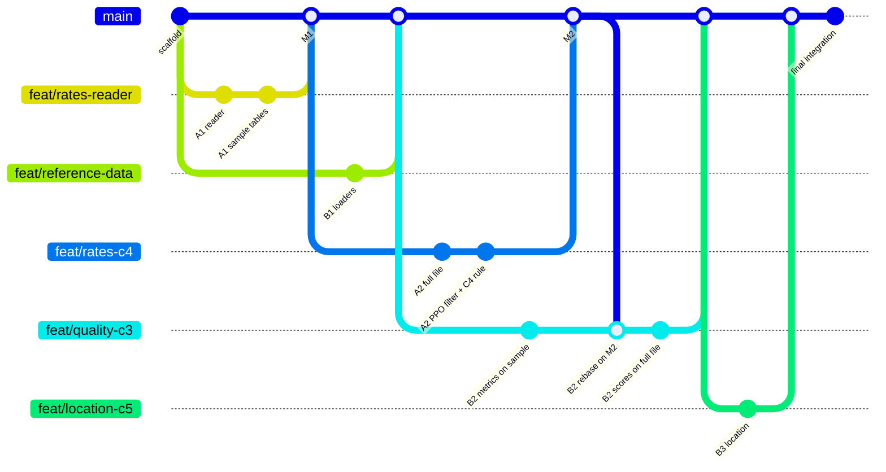

# Work split: C3, C4, C5 between two people

C1 and C2 are done and on `main`. The remaining work is split so that **each person owns separate files**. Two people never edit the same file, so merges can't conflict.

- **Person A: Rates.** Streams the CA rate file and delivers C4 (PPO rates for every provider, with the rate-selection rule). Branches: `feat/rates-reader` → `feat/rates-c4`.
- **Person B: Quality and providers.** Delivers C3 (file quality score) and the provider-location work (NPPES plus other sources). Branches: `feat/reference-data` → `feat/quality-c3` → `feat/location-c5`.

The only point where their work meets is a fixed **data contract** (`src/contracts.py`, described below): A writes those tables, and B reads them.

## 1. Who owns which files

Only the owner edits a file. Everything else is read-only for them.

| Owner | Files (create or edit freely) |
|---|---|
| **A: Rates** | `src/ptd_reader.py`, `src/c4_extract_rates.py`, `config/stages/c4.yaml`, `tests/test_ptd_reader.py`, `tests/test_c4.py`, `docs/logic_c4.md`, `outputs/c4/**` |
| **B: Quality and providers** | `src/reference_data.py`, `src/c3_quality.py`, `src/c5_provider_location.py`, `config/stages/c3.yaml`, `config/stages/c5.yaml`, `tests/test_reference_data.py`, `tests/test_c3.py`, `tests/test_c5.py`, `docs/logic_c3.md`, `docs/logic_c5.md`, `outputs/c3/**`, `outputs/c5/**` |
| **Frozen (nobody edits during the split)** | `src/common.py`, `src/run.py`, `src/contracts.py`, `config/config.yaml`, `requirements.txt`, `.gitignore`, `README.md`, `tests/conftest.py`, everything from C1/C2 (`src/c0_*`, `src/c1_*`, `src/c2_*`, `docs/logic_c1_c2.md`, `outputs/c1`, `outputs/c2`) |

Why this works:
- Every stage is already registered in `src/run.py`. Each stage has a stub module that its owner replaces, so nobody needs to touch `run.py`.
- Settings are split into one file per stage under `config/stages/`. `load_config` merges them automatically, so nobody edits `config/config.yaml`.
- `openpyxl` (needed to read the benchmark `.xlsx`) is already in `requirements.txt`.

**If a frozen file really must change** (a new library, a shared helper): make a separate tiny PR that changes only that, tell the other person, and merge it before continuing. Helpers that only one person needs go in that person's own module, not in `common.py`.

## 2. Stage order and who runs what

```bash
.venv/bin/python -m src.run --stage c4
```
```bash
.venv/bin/python -m src.run --stage c3
```
```bash
.venv/bin/python -m src.run --stage c5
```

`--stage all` runs: recon → c1 → c2 → **c4** (A) → **c3** (B) → **c5** (B). C4 runs before C3 because the quality score is computed on the extracted rate tables.

## 3. The data contract (A writes, B reads)

`src/contracts.py` defines the column lists and types. A calls `conform(df, RATES_LONG_COLUMNS)` before writing, and B can rely on exactly these columns. Changing the contract counts as a frozen-file change (see §1).

| Path | One row per | Key columns |
|---|---|---|
| `outputs/c4/<file_key>/file_header.json` | file | reporting entity, version, `last_updated_on`, bytes read/total, `complete`, counts of references/items/rates/prices/rows, `invalid_records` (reason → count) |
| `outputs/c4/<file_key>/provider_refs.parquet` | provider group × NPI | `provider_group_id`, `npi`, `tin_type`, `tin`, `business_name`, `network_name` |
| `outputs/c4/<file_key>/rates_long.parquet` | price × provider (fully exploded, nothing dropped) | billing code fields, `negotiated_type`, `negotiated_rate`, `expiration_date`, `billing_class`, `service_code`, `billing_code_modifier`, `npi`, `tin`, `provider_ref_resolved` |
| `outputs/c4/rates_selected.parquet` | provider × code × context (the C4 deliverable) | the kept rate, `n_candidate_rates`, `rate_min`, `rate_max`, `selection_rule`, `has_conflict` |

`<file_key>` is the C1 `file_key` from `outputs/c2/ppo_files.csv`.

Notes on the rows:
- `rates_long` keeps every row, including $0, expired and duplicate rows. Those are exactly what C3 measures, so A must not filter them.
- Rows whose provider reference can't be resolved have `provider_ref_resolved = False` and a null `npi`.

## 4. Inputs

| Input | Location (git-ignored) | Who adds it |
|---|---|---|
| Full PTD rate files (downloaded and cached) | `raw/ptd/` | A's code downloads them |
| NPPES `npidata_pfile_*.csv`, `pl_pfile_*.csv` | `raw/nppes/` | B (copy in by hand) |
| Benchmark xlsx, NUCC taxonomy, CMS DAC | `reference/` | B (copy in by hand) |

Large inputs live in `raw/`, not `data/`. On macOS the filesystem ignores case, so `data/` and the index folder `DATA/` would be the same folder.

## 5. Tasks and milestones

**Person A: Rates (C4)**
1. `ptd_reader.py`: download the file to `raw/ptd/` (resumable, HTTP range), then stream `provider_references` and `in_network` with ijson. Count invalid records by reason.
2. **Milestone A1, early:** write the contract tables for the first `c4.max_mb` (e.g. 50 MB) of the CA file and push them. B then has real-shaped data from day 1.
3. Full-file run: write `file_header.json`, `provider_refs`, `rates_long`.
4. Decide the PPO filter inside the MIXED file (open question Q3) and document it.
5. `rates_selected`: the selection rule (context kept apart → drop unusable → negotiated > fee schedule > derived → most frequent, median on ties), with a reason per row.
6. `docs/logic_c4.md` and tests on a small synthetic in-network fixture (its own fixture inside `tests/test_c4.py`, not in `conftest.py`).

**Person B: Quality and providers (C3, C5)**
1. `reference_data.py`: load the benchmark codes from the xlsx; stream NPPES with only the needed columns (NPI, practice state/zip, last update date, deactivation date, taxonomy) into a cached parquet; load `pl_pfile`, NUCC and DAC.
2. `c3_quality.py`: one function per metric, from `rates_long` + `provider_refs` + `file_header`. The metrics are schema validity, code coverage, provider coverage, $0/invalid rates, outliers, rate-type mix, duplicates, staleness and referential integrity. Each scores 0–1 from the raw value, and the weights come from `config/stages/c3.yaml`. Output: `outputs/c3/file_scores.csv` and `metric_details.json`. **Start on the synthetic sample** in `tests/test_contracts.py`, then switch to A's milestone A1 output.
3. `c5_provider_location.py`: location confidence from DAC, NPPES (lowered as the last update ages), `pl_pfile`, and in-file TIN names or county tags. Flag disagreements.
4. `docs/logic_c3.md`, `docs/logic_c5.md` and tests.

## 6. Branching and merging plan

The branches are **not** independent the whole way. C3 (B) is computed on the rate tables that A extracts. So nobody keeps one long branch. Each person works in **short branches, one per milestone**, and merges at two fixed sync points:

- **M1:** A's sample rate tables reach `main`.
- **M2:** A's full-file rates reach `main`.



### When each branch is created and merged

| Branch | Owner | Create it from `main` | Merge it into `main` when | What the other person does then |
|---|---|---|---|---|
| `feat/rates-reader` (A1) | A | Now, from the scaffold | The reader works and the contract tables for the first ~50 MB of the CA file are written (**M1**) | B can switch C3 from the synthetic sample to real-shaped tables |
| `feat/reference-data` (B1) | B | Now, from the scaffold | The NPPES, benchmark xlsx, NUCC and DAC loaders work, with tests | Nothing; A doesn't use these |
| `feat/rates-c4` (A2) | A | Right after M1 is merged | Full-file extraction, the PPO filter inside the MIXED file and the rate-selection rule are done, with `docs/logic_c4.md` (**M2**) | B rebases B2 onto `main` and re-runs C3 on the full file |
| `feat/quality-c3` (B2) | B | After **both** M1 and B1 are on `main` | All 9 metrics score the sample; after M2, they also score the full file, with `docs/logic_c3.md` | — |
| `feat/location-c5` (B3) | B | After B2 is merged | Location confidence is done, with `docs/logic_c5.md` | — |
| final integration | whoever merges last | After every branch above is merged | — | README, summary doc, `--stage all`, full test run (§7) |

A1 and B1 start on the same day, and neither waits for the other. Before M1, B2's work can begin on the synthetic sample in `tests/test_contracts.py`.

### Rules that keep merges conflict-free

1. **Always create a new branch from the latest `main`**, never from your previous feature branch:
   ```bash
   git switch main && git pull origin main && git switch -c feat/<next-branch>
   ```
2. **Merge as soon as a milestone works**, without waiting until everything is finished. Small, frequent merges keep conflicts away.
3. **Rebase onto `main` every day, and always right after M1 or M2 lands:**
   ```bash
   git fetch origin && git rebase origin/main
   ```
   On a branch that is already pushed, publish the rebased branch with:
   ```bash
   git push --force-with-lease
   ```
4. **Commit only your own files** (see §1). Check `git status` before every commit, and add files by path rather than with `git add -A`.
5. **Open a PR for every merge into `main`.** The other person skims it (a 5-minute check that only owned files changed and `pytest` passes), then it's merged with "Rebase and merge" or "Squash and merge".
6. **Frozen-file changes** (§1) go in their own tiny PR, merged before either person depends on them.
7. **Never commit `raw/` or large intermediates.** If `rates_long.parquet` is over about 50 MB, commit a sample and add the full file to `.gitignore` in a frozen-file PR.

## 7. Final integration (done once, by one person, after every branch is merged)

1. Branch `chore/final-integration` from the latest `main`.
2. Update `README.md` (stages table and current results) and the shared summary doc.
3. Run `--stage all` and `pytest` on a clean checkout, then merge.
4. Unfreeze the frozen files only after this merge.
